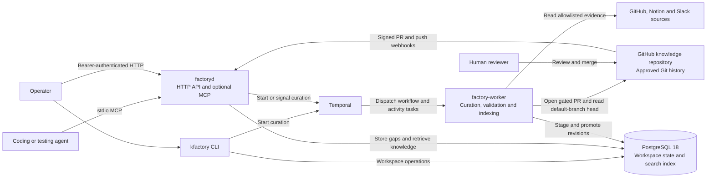

# Agent Knowledge Factory

Agent Knowledge Factory helps coding and testing agents retrieve approved knowledge and report gaps. A curator turns evidence-backed findings into proposed changes. A human reviews and merges the pull request in GitHub, and the factory indexes the approved revision for future retrieval.

## Architecture



Git holds the approved OKF concepts, Agent Skills, and data-access pages. PostgreSQL holds operational state and a rebuildable search index. Default retrieval reads the workspace's published revision, so changes in open pull requests stay out of agent search results. The banking repository, `dipjyotimetia/distributed-systems`, is a read-only evidence source.

See the [architecture guide](docs/architecture.md) for the knowledge lifecycle, publication gates, and interactive Archify diagram.

## Quick start

With Docker running, start the local stack and check the HTTP service.

```bash
make dev-up
curl --fail --silent --show-error http://localhost:8080/healthz
```

The stack starts `factoryd`, `factory-worker`, Temporal, and the databases. Temporal UI is at <http://localhost:8088>. See the [local development runbook](docs/runbooks/local-development.md) to initialize the workspace, attach an MCP client, and stop the stack.

For local builds and tests, the repository uses Go 1.27.4 in CI, PostgreSQL 18 for integration tests, and golangci-lint v2.15.0 for linting. After configuring the test database as described in the runbook, run `make test`. Use `make build` to build the three binaries into `bin/`.

## Banking demo

With the test database configured, run the learning-cycle integration test.

```bash
go test ./internal/demo -run '^TestBankingLearningCycle$' -count=1
```

Two agents report stale movement-event deduplication guidance. The curator uses a recorded Avro contract to propose changing the key from `movementId` to `eventId`. The test simulates a human merge, confirms search sees the correction only after publication, checks targeted retrieval improvement, and restores the original fixture revision. The test uses PostgreSQL and runs with recorded evidence, an in-memory publisher, and Temporal's test environment.

## Documentation

- [Operations guide](docs/operations-guide.md) for environment variables, workspace setup, CLI commands, and HTTP endpoints.
- [Security](docs/security.md) and the [GitHub App runbook](docs/runbooks/github-app.md) before configuring a live knowledge repository or credentials.
- [Architecture decisions](docs/adr/), [evaluation](docs/evaluation.md), and [implementation status](docs/plan-status.md) for design context and coverage.

Licensed under [Apache-2.0](LICENSE).
